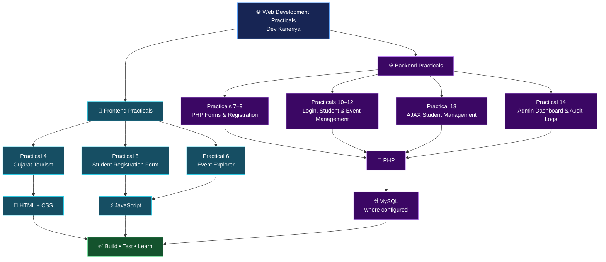

[README.md](https://github.com/user-attachments/files/34082388/README.md)
<div align="center">

# 🌐 Web Development Practicals

### A Practical Portfolio of Frontend & Backend Web Technologies

**A structured collection of academic practicals covering modern web development concepts, from interactive webpages to database-driven applications.**

<br>


<br>

**AUTHOR · DEV KANERIYA**

</div>

---

## 📌 About the Project

This repository contains a collection of **Web Development practicals** created to practise and demonstrate essential frontend and backend concepts. The work progresses from HTML-based pages and interactive forms to PHP applications, database operations, authentication, and administrative features.

Each practical is maintained in its own folder to make the source code easier to navigate, run, understand, and present during academic evaluation.

> **Project focus:** Learn by building — structure pages, style interfaces, add interactivity, process data, and connect applications to databases.

---

## ✨ Project Highlights

| Feature | Description |
|:--|:--|
| 🧱 **Frontend Development** | Build web pages using HTML and CSS. |
| ⚡ **JavaScript Interactivity** | Add client-side behaviour, form interactions, and dynamic content. |
| 🐘 **PHP Backend** | Process form submissions and implement server-side application logic. |
| 🗄️ **Database Integration** | Connect PHP applications to MySQL where required. |
| 🔐 **Authentication** | Practise login flows, sessions, and role-based features in relevant practicals. |
| 🔄 **CRUD Operations** | Create, read, update, and delete records in database-backed exercises. |
| 📡 **AJAX Concepts** | Exchange data with backend endpoints without relying only on full-page form submissions. |
| 🧰 **Version Control** | Organize and publish practical work using Git and GitHub. |

---

## 🗂️ Practical Index

| Practical | Project / Topic | Main Concepts |
|:--:|:--|:--|
| **04** | 🌄 Gujarat Tourism Website | HTML, CSS, JavaScript, page layout and tourism content |
| **05** | 📝 Student Registration Form | HTML forms, CSS styling and JavaScript |
| **06** | 🎟️ Event Explorer | JavaScript, JSON event data and modular scripts |
| **07** | 📋 Student Registration | PHP form processing and registration records |
| **08** | 🗃️ StudentHub Registration | PHP and MySQL connectivity |
| **09** | 👤 User Registration | PHP registration form and database connection |
| **10** | 🔐 Secure Login System | PHP authentication, sessions and role-based dashboards |
| **11** | 🎓 Student Management System | PHP/MySQL CRUD operations and CSV export |
| **12** | 📅 Event Management System | PHP/MySQL event management and admin sessions |
| **13** | 🔄 AJAX Student Management | PHP endpoints, AJAX-style requests and CRUD |
| **14** | 🛠️ Admin Dashboard & Audit Logs | User management, status controls and audit logs |

<sub>Practical titles and technologies are summarized from the project folder overview. Check each practical's files for its exact features and setup requirements.</sub>

---

## 🧭 Repository Flowchart

The diagram below gives a high-level view of how the practicals progress from frontend fundamentals to backend and database-driven applications.



---

## 🧰 Technology Stack

| Technology | Role in the Repository |
|:--|:--|
| **HTML5** | Page structure and forms |
| **CSS3** | Visual design, layout and styling |
| **JavaScript** | Client-side interactions and dynamic behaviour |
| **JSON** | Structured data for applicable exercises |
| **PHP** | Server-side processing and application logic |
| **MySQL** | Database storage for applicable exercises |
| **Git & GitHub** | Version control and repository hosting |

---

## 🚀 Getting Started

### 1. Clone the repository

```bash
git clone https://github.com/25it040/WDF-Web-development-.git
cd WDF-Web-development-
```

### 2. Run frontend practicals

1. Open the required practical folder in Visual Studio Code.
2. Open its `index.html` file in a browser, or use the **Live Server** extension.
3. Keep the original folder structure intact so stylesheets, scripts, images, and JSON files resolve correctly.

### 3. Run PHP and MySQL practicals

1. Install a local PHP/MySQL environment such as **XAMPP**.
2. Start **Apache** and **MySQL**.
3. Place the required project folder in the web server's document root (commonly `htdocs` in XAMPP).
4. Check that practical's PHP database configuration and set the correct local credentials.
5. Import the corresponding `.sql` file into MySQL/phpMyAdmin if one is provided.
6. Open the PHP entry point through `http://localhost/your-folder/`.

> **Setup note:** Each practical may use different database names, tables, or configuration values. Follow the instructions and SQL files inside that specific folder. Never commit real passwords, API keys, or other secrets to a public repository.

---

## 🎯 Learning Outcomes

By exploring these practicals, students can practise:

- Creating structured webpages with HTML and CSS.
- Adding interactive behaviour using JavaScript.
- Working with forms and submitted data.
- Organizing structured JSON data and JavaScript files.
- Building server-side features with PHP.
- Connecting web applications to MySQL.
- Implementing CRUD workflows.
- Understanding authentication, sessions, and role-based access.
- Using backend endpoints for AJAX-style communication.
- Managing and publishing source code with Git and GitHub.

---

## 📁 Repository Structure

```text
WDF-Web-development-/
├── PRACTICAL-4/       # Gujarat Tourism Website
├── PRACTICAL-5/       # Student Registration Form
├── PRACTICAL-6/       # Event Explorer
├── PRACTICAL_7/       # PHP Student Registration
├── PRACTICAL_8/       # StudentHub Registration
├── PRACTICAL_9/       # User Registration
├── PRACTICAL_10/      # Login System
├── PRACTICAL_11/      # Student Management
├── PRACTICAL_12/      # Event Management
├── PRACTICAL_13/      # AJAX Student Management
└── PRACTICAL_14/      # Admin Dashboard & Audit Logs
```

*This is a simplified overview. Individual folders may contain additional PHP, CSS, JavaScript, SQL, image, or sample-data files.*

---

## 🎓 Academic Context

This repository is maintained as part of **Web Development coursework**. The practicals are intended to support hands-on learning, implementation, testing, and academic demonstration.

## 👨‍💻 Author

<div align="center">

### **Dev Kaneriya**

*Web Development Practicals · Academic Project*

</div>

---

<div align="center">

**Built for learning. Organized for clarity. Presented with purpose.**

</div>
