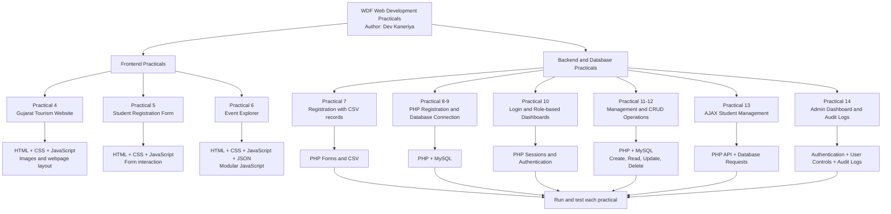

Web Development Practicals
Practical Portfolio | HTML • CSS • JavaScript • PHP • MySQL
Author: Dev Kaneriya
Repository: WDF-Web-development-
About the Project
This repository contains a collection of Web Development practicals created to practise and demonstrate core frontend and backend web technologies. The practicals progress from interactive webpages and forms to database-driven applications, authentication, CRUD operations, AJAX-based updates, and admin features.
The code is organized into individual practical folders so that each exercise can be explored and run independently.
Practical Index
Practical	Project / Topic	Technologies and Concepts
Practical 4	Gujarat Tourism Website	HTML, CSS, JavaScript, page layout, tourism content and images
Practical 5	Student Registration Form	HTML forms, CSS styling and JavaScript
Practical 6	Event Explorer	HTML, CSS, JavaScript, JSON event data and modular JavaScript files
Practical 7	Student Registration	PHP form processing, registration records and CSV data
Practical 8	StudentHub Registration	PHP and MySQL database connectivity
Practical 9	User Registration	PHP registration form and database connection
Practical 10	Secure Login System	PHP authentication, sessions and role-based dashboards
Practical 11	Student Management System	PHP/MySQL CRUD operations, editing, deletion and CSV export
Practical 12	Event Management System	PHP/MySQL event management, admin login and session handling
Practical 13	AJAX Student Management	PHP API endpoints, AJAX-style requests and CRUD operations
Practical 14	Admin Dashboard and Audit Logs	PHP authentication, user management, status controls and audit logs

Folder names follow the practical files in this repository. Check each practical's source files and SQL script for its exact implementation and database requirements.

Technology Stack
- HTML5 — page structure and forms
- CSS3 — layout, styling and responsive presentation where implemented
- JavaScript — client-side interaction and dynamic behaviour
- JSON — structured event data
- PHP — server-side processing, authentication and application logic
- MySQL — persistent data storage for database-backed practicals
- Git and GitHub — source control and project hosting
Repository Flowchart
The diagram below gives a quick visual overview of how the practicals are grouped, from frontend fundamentals to PHP/MySQL applications.

How to read this chart: Practicals 4–6 focus on frontend development. Practicals 7–14 introduce server-side PHP, data storage, authentication and management features. Open each practical folder for its own entry point and configuration.

Repository Structure
WDF-Web-development-/
├── PRACTICAL-4/
│   ├── PAGES/
│   ├── images/
│   ├── script4.js
│   └── style4.css
├── PRACTICAL-5/
│   ├── index.html
│   ├── script.js
│   └── style.css
├── PRACTICAL-6/
│   ├── index.html
│   ├── events.json
│   ├── js/
│   └── style.css
├── PRACTICAL_7/
├── PRACTICAL_8/
├── PRACTICAL_9/
├── PRACTICAL_10/
├── PRACTICAL_11/
├── PRACTICAL_12/
├── PRACTICAL_13/
└── PRACTICAL_14/
Some folders contain additional PHP, CSS, JavaScript, SQL, image, or sample-data files not shown in this overview.
How to Run the Practicals
1. Clone the repository
git clone https://github.com/25it040/WDF-Web-development-.git
cd WDF-Web-development-
2. Run HTML/CSS/JavaScript practicals
1. Open the required folder, such as PRACTICAL-4, PRACTICAL-5, or PRACTICAL-6.
2. Open its index.html file in a browser, or use the Live Server extension in Visual Studio Code.
3. Keep the folder structure intact so linked stylesheets, scripts, images and JSON files can be found.
3. Run PHP/MySQL practicals
1. Install a local PHP/MySQL environment such as XAMPP.
2. Start Apache and MySQL.
3. Copy the project folder into the web server's document root (commonly htdocs in XAMPP).
4. Read the relevant practical's db.php file and configure the database host, database name, username and password for your local environment.
5. Import that practical's included .sql file into phpMyAdmin/MySQL, when provided.
6. Open the relevant PHP entry point through http://localhost/your-folder/.
Important: Database names, table definitions and connection settings can differ between practicals. Use the SQL file and PHP configuration belonging to the specific practical. Do not publish real passwords, API keys or other secrets in a public repository.
Learning Outcomes
Through these practicals, the repository demonstrates practice with:
- Structuring webpages using HTML and styling them with CSS.
- Adding client-side behaviour with JavaScript.
- Working with forms and validating or processing submitted data.
- Reading structured JSON data and organizing JavaScript code into modules.
- Connecting PHP applications to MySQL.
- Implementing create, read, update and delete (CRUD) operations.
- Managing login sessions and user roles.
- Exchanging data through PHP endpoints and AJAX-style interactions.
- Organizing project files and maintaining code with Git/GitHub.
Academic Purpose
This repository is maintained as part of Web Development coursework and practical learning. Each folder represents an individual practical exercise intended for learning, implementation, testing and academic demonstration.
Author
Dev Kaneriya
Web Development Practicals
For academic and learning use. Review each practical's code and configuration before running it in your local environment.
